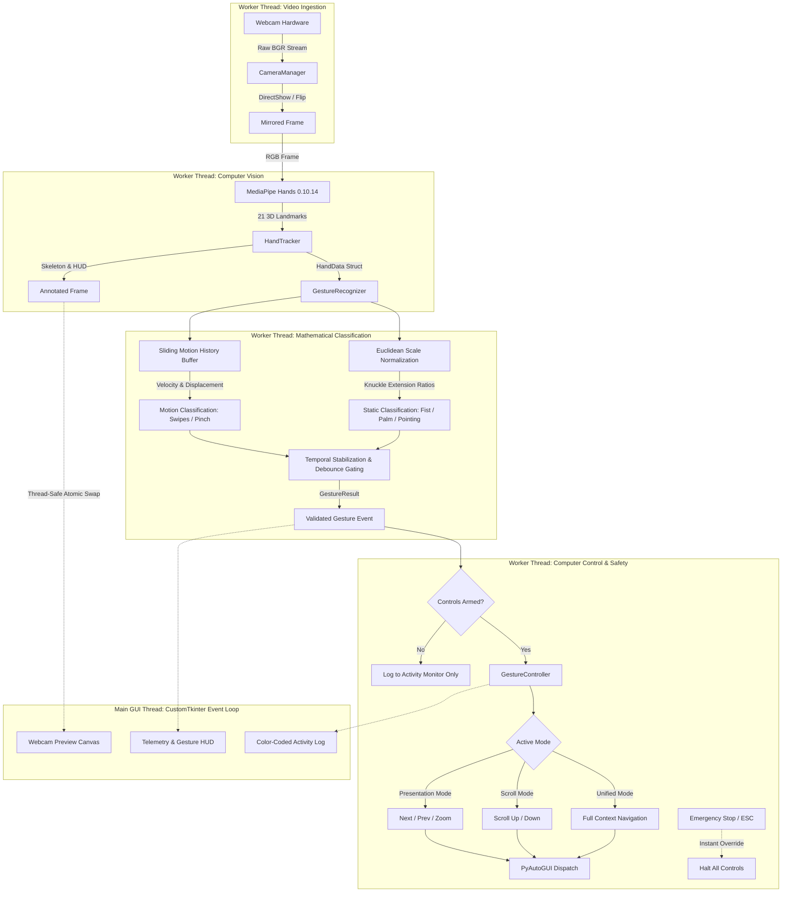

# ⚡ GestureFlow — AI-Powered Hand Gesture Controller

[](https://www.python.org/)
[](https://opencv.org/)
[](https://developers.google.com/mediapipe)
[](https://github.com/TomSchimansky/CustomTkinter)
[](tests/)
[](LICENSE)

> **Real-time, touchless computer interaction powered by computer vision and deep-learning landmark estimation.** Control presentations, zoom documents, and navigate web pages using intuitive hand movements through your standard webcam—no physical mouse or specialized hardware required.

---

## 📌 Resume & Portfolio Showcase

* **GitHub Repository Tagline:**
  > *A real-time, touchless AI hand gesture control system built with Python, OpenCV, MediaPipe, NumPy, and PyAutoGUI, featuring mathematical landmark classification, directional velocity filtering, multi-threaded perception, and a safety-first CustomTkinter desktop interface.*

* **Resume-Ready Project Description:**
  > *Engineered **GestureFlow**, an on-device computer vision desktop application enabling touchless computer interaction via webcam. Designed a multi-threaded perception pipeline using MediaPipe Hands (21 3D landmarks) and OpenCV with sub-25ms inference latency. Developed geometric posture classifiers and temporal motion buffers to differentiate directional swipes, pinch-to-zoom, and vertical pointing from stationary jitter. Implemented a decoupled CustomTkinter UI with real-time HUD telemetry, failsafe computer control gating, and an automated 30-test suite.*

* **Key Portfolio Bullet Points:**
  * *Architected an asynchronous, multi-threaded computer vision pipeline in Python that decouples webcam frame ingestion and MediaPipe neural inference from the CustomTkinter UI event loop, maintaining a responsive 60 FPS dashboard.*
  * *Developed mathematical hand landmark classification algorithms combining knuckle-relative Euclidean expansion ratios, arc-tangent pointing angles ($\pm 35^\circ$), and sliding-window velocity vectors to recognize 7 distinct gestures with zero stationary false positives.*
  * *Engineered rigorous safety mechanisms around PyAutoGUI with disabled-by-default execution, temporal cooldown debouncing (0.2s - 1.0s), native mouse fail-safe protection, and instant hardware emergency stops (`Esc` / `Q`).*
  * *Built a comprehensive test suite of 30 unit tests (100% pass rate) with synthetic landmark fixtures validating motion thresholds, missing inputs, and mode-switching isolation without hardware dependencies.*

---

## 📖 Table of Contents

1. [Problem Statement](#-problem-statement)
2. [Core Features](#-core-features)
3. [Gesture-to-Action Reference](#-gesture-to-action-reference)
4. [Control Modes Explained](#-control-modes-explained)
5. [System Architecture & Workflow](#-system-architecture--workflow)
6. [Technology Stack](#-technology-stack)
7. [Installation & Windows / VS Code Setup](#-installation--windows--vs-code-setup)
8. [Running the Application](#-running-the-application)
9. [Automated Testing & Verification](#-automated-testing--verification)
10. [Safety & Reliability Architecture](#-safety--reliability-architecture)
11. [Troubleshooting Guide](#-troubleshooting-guide)
12. [Known Limitations](#-known-limitations)
13. [Screenshots & Demo Placeholders](#-screenshots--demo-placeholders)
14. [Future Enhancements](#-future-enhancements)
15. [GitHub Upload Instructions](#-github-upload-instructions)

---

## 🎯 Problem Statement

Presenters and educators often remain tethered to their laptops, rely on third-party remote clickers (which require batteries and USB dongles), or struggle to navigate slides while moving around a room or lecture hall. Similarly, in sterile or hands-busy environments (such as culinary settings, laboratories, or medical imaging), physically touching mice and keyboards is unhygienic or impractical.

**GestureFlow** solves this by converting any standard RGB laptop webcam or external USB camera into a natural touchless interface. By processing 21 hand landmarks locally on the CPU with sub-25ms latency, it empowers users to deliver dynamic slide presentations, zoom into visual diagrams, and scroll through documents using fluid, contactless gestures.

---

## ✨ Core Features

### 1. Real-Time Hand Tracking Pipeline
* **High-Accuracy Hand Tracking:** Leverages Google MediaPipe Hands ML pipeline to detect 21 3D landmarks ($x, y, z$) per hand at 30+ FPS.
* **Mirrored Video Stream:** Automatically mirrors horizontal camera preview (`cv2.flip(frame, 1)`) so on-screen movement is completely intuitive.
* **Sleek HUD Overlays:** Renders luminous skeleton connections, fingertip indicators, palm center reticles, and tech-style corner bounding boxes directly on the frame.
* **Camera Auto-Probe:** Probes default index `0` with graceful fallback to indices `1` and `2`, powered by Windows DirectShow (`CAP_DSHOW`) for low-latency initialization.
* **Resource Cleanup:** Safely releases camera capture handles and closes MediaPipe sessions upon application exit.

### 2. Seven Distinct Gesture Controls
1. **Fist (✊):** Stable closed-fist posture. Activates/arms the selected control mode without repeated chatter.
2. **Swipe Right (👉):** Rapid lateral hand sweep to the right. Advances to the next slide or navigates forward.
3. **Swipe Left (👈):** Rapid lateral hand sweep to the left. Returns to the previous slide or navigates backward.
4. **Pinch Out (🤏):** Thumb and index finger distance expansion. Triggers zoom-in without interference from normal hand movements. Also supports two-hand zoom expansion.
5. **Index Finger Up (☝️):** Single extended index finger pointing upward within angular tolerance ($\pm 35^\circ$). Triggers upward scrolling.
6. **Index Finger Down (👇):** Single extended index finger pointing downward within angular tolerance ($\pm 35^\circ$). Triggers downward scrolling.
7. **Open Palm (🖐️):** Stable five-finger open posture when hand is stationary. Safely disarms/pauses active controls.

### 3. Safety & Computer Control Layer
* **Disabled-by-Default:** PyAutoGUI computer control actions remain strictly disarmed until the user explicitly clicks **"Enable Controls"** or executes an authorized Fist wake gesture.
* **Prominent Emergency Stop:** Dedicated red killswitch in GUI and global keyboard shortcuts (`Esc` or `Q`) to halt all computer actions immediately.
* **Anti-Chatter Debouncing:** Configurable cooldowns (0.2s - 1.0s) and multi-frame stability gates prevent accidental duplicate triggers.
* **Fail-Safe Protection:** Native `pyautogui.FAILSAFE` enabled to prevent runaway mouse/keyboard loops.
* **No Destructive Commands:** Strictly limits inputs to non-disruptive navigation keys (arrows, Ctrl+Plus, mouse scroll). Never performs system shutdowns, restarts, or logouts.

### 4. Asynchronous Multi-Threaded Desktop UI
* **Non-Blocking Architecture:** Video capture, MediaPipe inference, and gesture classification execute on a dedicated background worker thread (`GestureFlowCVWorker`), leaving the CustomTkinter GUI thread at a silky 60 FPS.
* **Dark Aesthetics:** Tailored slate palette (`#0f172a`, `#1e293b`) with restrained royal blue accents (`#2563eb`).
* **Live Telemetry HUD:** Displays real-time FPS, frame latency (ms), active gesture badge, and confidence percentage.
* **Live Activity Log:** Scrollable, color-coded terminal log tracking detected gestures, executed actions, and system states.
* **Reference Card:** In-app quick-reference cheat sheet for immediate gesture guidance.

---

## 🖐️ Gesture-to-Action Reference

| Visual Gesture | Gesture Name | Target Action | Mode Availability | Technical Logic |
| :---: | :---: | :---: | :---: | :--- |
| ✊ | **Fist** | **Activate / Arm Controls** | All Modes | All 4 fingers curled + thumb folded across palm ($\text{ratio} < 1.1$) |
| 👉 | **Swipe Right** | **Next Slide** (`Right Arrow`) | Presentation / Unified | Hand extended, lateral displacement $\Delta x > +0.14$, velocity $v_x > +0.38\text{ s}^{-1}$ |
| 👈 | **Swipe Left** | **Previous Slide** (`Left Arrow`) | Presentation / Unified | Hand extended, lateral displacement $\Delta x < -0.14$, velocity $v_x < -0.38\text{ s}^{-1}$ |
| 🤏 | **Pinch Out** | **Zoom In** (`Ctrl + +`) | Presentation / Unified | Thumb & index tips expanding outward ($\Delta \text{dist} > 0.06$) or two hands spreading |
| ☝️ | **Pointing Up** | **Scroll Up** (`+180px`) | Scrolling / Unified | Index extended, vertical vector angle within $-90^\circ \pm 35^\circ$, other fingers curled |
| 👇 | **Pointing Down** | **Scroll Down** (`-180px`) | Scrolling / Unified | Index extended, vertical vector angle within $+90^\circ \pm 35^\circ$, other fingers curled |
| 🖐️ | **Open Palm** | **Safe Stop / Pause Controls** | All Modes | All 5 fingers extended, hand stationary ($\text{speed} < 0.28\text{ s}^{-1}$) |

---

## 🎛️ Control Modes Explained

GestureFlow provides dedicated operating modes selectable from the top dashboard:

### A. Presentation Mode
Tailored specifically for keynote presentations, slide decks (Microsoft PowerPoint, Google Slides, Keynote), and document viewers:
* **Swipe Right:** Sends `Right Arrow` to advance to the next slide.
* **Swipe Left:** Sends `Left Arrow` to return to the previous slide.
* **Pinch Out:** Sends `Ctrl + +` to zoom into visual charts and slide details.
* **Fist:** Arms or resumes presentation control.
* **Open Palm:** Immediately pauses gesture controls so you can speak and gesture naturally without advancing slides.

### B. Scroll Mode
Tailored for reading long PDFs, research papers, documentation, and web browsing:
* **Index Finger Up:** Scrolls the active window upward (`+180px`).
* **Index Finger Down:** Scrolls the active window downward (`-180px`).
* **Open Palm:** Immediately pauses gesture control.
* **Fist:** Arms or resumes scroll control.
* Presentation gestures (Swipes / Pinch) are intentionally ignored in this mode to avoid accidental slide transitions while scrolling.

### C. Unified Mode
Combines presentation navigation and document scrolling into a single contextual profile for power users.

---

## 🏗️ System Architecture & Workflow



---

## 🛠️ Technology Stack

| Layer | Library / Tool | Verified Version | Purpose |
| :--- | :--- | :--- | :--- |
| **Language** | Python | 3.12 (64-bit) | Core runtime environment |
| **Computer Vision** | OpenCV (`opencv-python`) | 5.0.0 / 4.10+ | Webcam capture, DirectShow backend, image processing, annotations |
| **Landmark Tracking** | Google MediaPipe | 0.10.14 | On-device 21-point hand landmark deep learning model |
| **Math & Vectors** | NumPy | 2.5.4 | Array transformations, coordinate projections, vector algebra |
| **OS Automation** | PyAutoGUI | 0.9.54 | Authorized keyboard and mouse simulation |
| **GUI Framework** | CustomTkinter & Pillow | 6.0.0 / 13.0+ | Modern dark-themed responsive desktop interface |
| **Unit Testing** | PyTest | 9.1.1 | Automated non-hardware testing suite (30 unit tests) |

---

## 🚀 Installation & Windows / VS Code Setup

### 1. Prerequisites
* **Operating System:** Windows 10, Windows 11 (or macOS / Linux)
* **Python Version:** Python 3.12 (64-bit recommended for pre-built MediaPipe binary wheels)
* **Hardware:** Any standard internal or USB webcam

### 2. Clone the Repository
```bash
git clone https://github.com/your-username/gesture-flow.git
cd gesture-flow
```

### 3. Set Up Virtual Environment (Recommended)
Open PowerShell or Command Prompt in the project folder:
```powershell
# Create Python 3.12 virtual environment
python -m venv .venv

# Activate the virtual environment
.venv\Scripts\activate
```

### 4. Install Dependencies
```powershell
pip install --upgrade pip
pip install -r requirements.txt
```

### 5. Windows Defender / Controlled Folder Access Notice
If your workspace is located in Windows `Documents` or OneDrive and Windows Defender Ransomware Protection is enabled:
1. Open **Windows Security** from the Start Menu.
2. Navigate to **Virus & threat protection** > **Manage ransomware protection**.
3. Ensure **Controlled folder access** allows your Python executable or is set to Off during development.

### 6. VS Code Configuration
1. Open the project folder in VS Code (`File > Open Folder...`).
2. Press `Ctrl + Shift + P` and search for **Python: Select Interpreter**.
3. Choose your virtual environment interpreter (`.venv\Scripts\python.exe`) or Python 3.12.
4. Open a terminal in VS Code (`Ctrl + ~`) and verify:
   ```powershell
   python --version
   # Expected: Python 3.12.x
   ```

---

## 💻 Running the Application

Launch the desktop interface:
```powershell
# Default execution (Python 3.12)
python main.py
```

### Optional Command-Line Arguments
```powershell
# Launch on a specific secondary webcam (e.g. external USB cam index 1)
python main.py --camera-index 1

# Specify custom capture dimensions
python main.py --width 1280 --height 720

# Disable horizontal mirror preview
python main.py --no-mirror

# View help and usage
python main.py --help
```

---

## 🧪 Automated Testing & Verification

The project includes an automated test suite across two dedicated test files (`test_gesture_recognition.py` and `test_gesture_controller.py`) that validate geometric classification, velocity thresholds, missing inputs, and safety boundaries **without requiring a physical webcam**:

```powershell
pytest -v tests/
```

### Test Suite Execution Output (30 of 30 Passed):
```
============================= test session starts =============================
platform win32 -- Python 3.12.0, pytest-9.1.1, pluggy-1.7.0
rootdir: C:\path\to\GestureFlow
collected 30 items

tests/test_gesture_controller.py::TestControllerSafety::test_controls_disabled_by_default PASSED
tests/test_gesture_controller.py::TestControllerSafety::test_actions_blocked_when_disarmed PASSED
tests/test_gesture_controller.py::TestControllerSafety::test_untriggered_gestures_produce_no_actions PASSED
tests/test_gesture_controller.py::TestControllerSafety::test_emergency_stop_halts_everything PASSED
tests/test_gesture_controller.py::TestPresentationMode::test_presentation_navigation_actions PASSED
tests/test_gesture_controller.py::TestPresentationMode::test_presentation_mode_ignores_scroll_gestures PASSED
tests/test_gesture_controller.py::TestPresentationMode::test_fist_activates_presentation_mode PASSED
tests/test_gesture_controller.py::TestPresentationMode::test_fist_avoids_repeated_activation PASSED
tests/test_gesture_controller.py::TestPresentationMode::test_open_palm_disables_controls PASSED
tests/test_gesture_controller.py::TestScrollMode::test_scroll_actions PASSED
tests/test_gesture_controller.py::TestScrollMode::test_scroll_mode_ignores_swipe_gestures PASSED
tests/test_gesture_controller.py::TestUnifiedMode::test_unified_mode_handles_all_gestures PASSED
tests/test_gesture_recognition.py::TestGestureClassification::test_fist_recognition PASSED
tests/test_gesture_recognition.py::TestGestureClassification::test_open_palm_recognition PASSED
tests/test_gesture_recognition.py::TestGestureClassification::test_pointing_up_recognition PASSED
tests/test_gesture_recognition.py::TestGestureClassification::test_pointing_down_recognition PASSED
tests/test_gesture_recognition.py::TestGestureClassification::test_pointing_horizontal_not_pointing_up_or_down PASSED
tests/test_gesture_recognition.py::TestMotionGestures::test_swipe_right_motion_detection PASSED
tests/test_gesture_recognition.py::TestMotionGestures::test_swipe_left_motion_detection PASSED
tests/test_gesture_recognition.py::TestMotionGestures::test_stationary_hand_does_not_trigger_swipe PASSED
tests/test_gesture_recognition.py::TestMotionGestures::test_pinch_out_expansion_detection PASSED
tests/test_gesture_recognition.py::TestCooldownAndDebouncing::test_isolated_single_frame_noise_filtered_out PASSED
tests/test_gesture_recognition.py::TestCooldownAndDebouncing::test_cooldown_prevents_immediate_repeated_trigger PASSED
tests/test_gesture_recognition.py::TestInvalidAndMissingInputs::test_empty_hands_list PASSED
tests/test_gesture_recognition.py::TestInvalidAndMissingInputs::test_none_hands_input PASSED
tests/test_gesture_recognition.py::TestInvalidAndMissingInputs::test_hand_with_truncated_landmarks PASSED
tests/test_gesture_recognition.py::TestGestureControllerSafety::test_actions_blocked_when_controls_disabled PASSED
tests/test_gesture_recognition.py::TestGestureControllerSafety::test_actions_executed_when_controls_enabled PASSED
tests/test_gesture_recognition.py::TestGestureControllerSafety::test_open_palm_disables_controls_safely PASSED
tests/test_gesture_recognition.py::TestGestureControllerSafety::test_emergency_stop_halts_all_controls PASSED

======================= 30 passed in 1.59s ========================
```

---

## 🔒 Safety & Reliability Architecture

* **100% Local Processing:** Video frames are captured directly from hardware into RAM and processed entirely on-device. No camera data, video frames, or landmark coordinates are saved to disk, transmitted over networks, or logged.
* **Separation of Concerns:** Computer vision inference (`app/gesture_recognition.py`), camera hardware (`app/camera.py`), and computer input (`app/gesture_controller.py`) are strictly decoupled from the presentation layer (`app/ui.py`).
* **Hardware Resource Protection:** The camera handle is automatically closed and released when stopping the camera, changing devices, or closing the application.

---

## 🔍 Troubleshooting Guide

| Issue | Root Cause | Solution |
| :--- | :--- | :--- |
| **"Could not connect to any camera"** | Another app is using the webcam (e.g. Zoom, Teams) or permissions blocked. | Close background video applications. Verify webcam privacy settings in Windows Settings > Privacy & Security > Camera. |
| **PyAutoGUI FailSafe Exception** | Mouse cursor moved to the absolute corner `(0, 0)` of the monitor. | Native PyAutoGUI safety feature. Move your mouse towards the center of your screen to resume. |
| **AttributeError: module 'mediapipe' has no attribute 'solutions'** | Incompatible modern MediaPipe version (1.x or 0.10.35+) installed. | Run `pip install mediapipe==0.10.14`. This version bundles the full `solutions.hands` pipeline. |
| **Laggy or low FPS on preview** | CPU throttling or high resolution. | Ensure your laptop is plugged in (High Performance mode). Launch with `python main.py --width 640 --height 480`. |
| **Swipes not triggering** | Hand moving too slowly or stationary. | Perform a brisk, fluid horizontal motion across at least 15% of the frame with your palm open. |
| **Action triggered twice** | Cooldown too short for presentation software. | Cooldowns can be customized in `app/config.py` under `CooldownConfig(swipe_cooldown=0.90)`. |

---

## ⚠️ Known Limitations

1. **Target Application Focus:** PyAutoGUI injects simulated OS-level keystrokes (`Right Arrow`, `Left Arrow`, `Ctrl + +`). For an action to affect a presentation or document, that target application must have active window focus.
2. **Extreme Low-Light Conditions:** MediaPipe Hands landmark confidence drops significantly in poorly lit environments. For optimal tracking, use reasonable ambient or room lighting.
3. **Partial Hand Occlusions:** If more than 50% of the hand is occluded by objects or cut off by the webcam frame edge, MediaPipe may lose tracking until the hand returns into full view.

---

## 📸 Screenshots & Demo Placeholders

> *Note: Placeholders below can be updated with real application captures by placing PNGs into `assets/screenshots/`.*

| Dashboard Overview | Live Hand Tracking HUD |
| :---: | :---: |
|  |  |
| *Modern Dark Theme Dashboard with Controls & Telemetry* | *MediaPipe 21-Landmark Skeleton Overlay & Reticle* |

---

## 🔮 Future Enhancements

* **Custom Gesture Creator:** User-trainable dynamic gestures using One-Euro filtering or DTW (Dynamic Time Warping).
* **Virtual Air Mouse:** Single-finger raycasting to move mouse cursor with pinch-to-click.
* **Multi-Display Presentation Mode:** Dedicated floating overlay widget that sits atop PowerPoint in presentation full-screen mode.
* **Audio Feedback:** Subtle audio cues / clicks upon confirmed gesture recognition.

---

## 🤝 GitHub Upload Instructions

```bash
# 1. Initialize git (if starting fresh)
git init

# 2. Stage verified source code
git add .

# 3. Commit
git commit -m "feat: Initial release of GestureFlow — AI Hand Gesture Controller"

# 4. Set remote and push
git remote add origin https://github.com/your-username/gesture-flow.git
git branch -M main
git push -u origin main
```

---

## 📜 License

This project is licensed under the **MIT License** — feel free to use, modify, and build upon it for portfolio, educational, or commercial projects.
